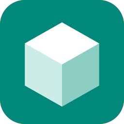

# 3DsetuPia – 3D print settings assistant

🇹🇷 [Türkçe README](README.md)

**3DsetuPia** is a Windows program that reads your slicer project, tunes dozens of print
settings **for that model**, and writes a new, improved **3MF** file.

- Works with projects from **Bambu Studio, QIDI Studio, OrcaSlicer** and slicers of the same family.
- **Reads the printer from the file**, and can move the project to another printer using that
  printer's own profiles, placing the objects on the new bed.
- **Changes nothing without asking**: suggestions come with reasons, you pick.
- **Never touches your original file**: the result is written to `…_ayarci.3mf`.

## What it does

1. Opens a 3MF project, a settings-free 3MF (CAD export), an STL or an OBJ.
2. Measures the model locally (size, bed contact, overhangs, wall thickness, flat tops,
   tipping risk, organic vs. mechanical shape).
3. Reads the current printer, nozzle, plate, process and filaments. On multi-nozzle printers
   (e.g. Bambu H2C) it follows the nozzle and filament the model actually prints with.
4. Prepares settings across Quality, Strength, Speed, Support, Others and Filament, with the AI
   of your choice (Claude, OpenAI, Gemini, Ollama…) or with built-in rules (no AI).
5. Passes everything through a safety filter (whitelist, safe ranges, values written the way the
   target slicer accepts them).
6. Writes the new 3MF. Open it in your slicer and press **Slice**.

## Moving a project to another printer

Pick your printer under **Which printer will print it?**. 3DsetuPia then:

- takes printer, process and filament profiles from the **manufacturer's profiles** installed
  with your slicer (machine settings and G-code are copied as they are, never invented);
- matches each filament to the closest profile (same product, same brand, otherwise Generic);
- centres the objects on the new bed keeping their arrangement; re-packs them if they do not fit
  together and reports anything that cannot fit on its own (never scales without asking);
- keeps colours, painting and per-object settings.

Converting another printer's project to a multi-nozzle printer (H2D, H2C…) is not supported yet:
open it in Bambu Studio, pick the printer, save, then use 3DsetuPia. Tuning projects that are
already for those printers works fully.

## Install

1. Download `3DsetuPia.exe` from [Releases](https://github.com/Keanyy/3DsetuPia/releases).
   No installation needed.
2. If Windows SmartScreen warns, choose **More info › Run anyway** (the program is not code-signed;
   the source is in this repository).
3. Have Bambu Studio, QIDI Studio or OrcaSlicer installed: the printer list and profiles come from them.

Details and troubleshooting: [docs/KURULUM.md](docs/KURULUM.md) (Turkish, with English notes).

## AI (optional)

**AI setup** tab: no AI (local rules, default), Anthropic Claude (default model `claude-opus-5-5`),
OpenAI, Google Gemini, OpenRouter, DeepSeek, Groq, Mistral, Ollama, LM Studio, or any
OpenAI-compatible URL.

## Privacy

Your 3D model is never uploaded. The AI only receives measurements computed on your PC and the
current setting values. Your API key stays on this PC (`%APPDATA%\3DsetuPia`) and is never sent to the page.

## Known limits

- Settings are shared by all objects on a plate. With several filaments, the one the model uses
  most is tuned (you can pick another). Speeds/accelerations can go at most 30 % above the profile.
- PrusaSlicer and Cura projects use a different format and are not supported yet.

## OrcaSlicer plugin

The same assistant is also packaged as `ayarci.py` for OrcaSlicer 2.5's plugin system (applies
settings inside Orca). See [docs/KURULUM.md](docs/KURULUM.md#orcaslicer-eklentisi).

## Contributing and support

Issues: [GitHub Issues](https://github.com/Keanyy/3DsetuPia/issues) ·
code: [CONTRIBUTING.md](CONTRIBUTING.md), [docs/GELISTIRME.md](docs/GELISTIRME.md) ·
optional support: the **Sponsor** button. A star ⭐ or a bug report helps just as much.

## License

[GNU AGPL-3.0](LICENSE). 3DsetuPia is an independent community project, not affiliated with
Bambu Lab, QIDI, OrcaSlicer/SoftFever or any AI provider. Settings are suggestions; always check
the slicer preview before printing.
