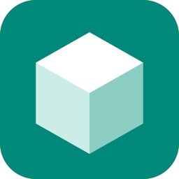
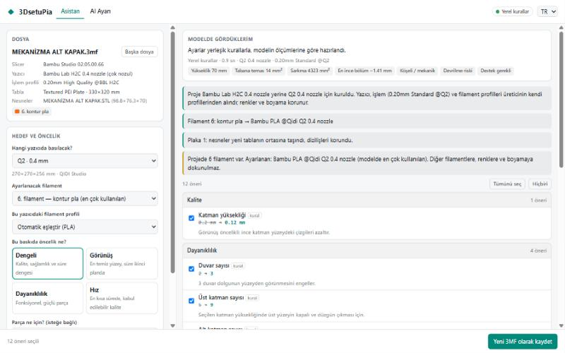

# 3DsetuPia – 3D baskı ayarı asistanı

🇬🇧 [English README](README.en.md)

**3DsetuPia**, slicer projenizi okuyup **o modele göre** onlarca baskı ayarını düzenleyen,
sonra yeni ve iyileştirilmiş bir **3MF** dosyası yazan bir Windows programıdır.

- **Bambu Studio, QIDI Studio, OrcaSlicer** ve aynı aileden slicer'ların projeleriyle çalışır.
- **Yazıcıyı dosyadan okur.** İsterseniz projeyi başka bir yazıcıya taşır: o yazıcının kendi
  profillerini kullanır ve nesneleri yeni tablaya yerleştirir.
- **Hiçbir şeyi sormadan değiştirmez.** Önerileri nedenleriyle listeler, siz seçersiniz.
- **Asıl dosyanıza dokunmaz.** Sonuç `…_ayarci.3mf` adıyla yeni bir dosyaya yazılır.

## ⬇️ [Windows için indir: 3DsetuPia.exe](https://github.com/Keanyy/3DsetuPia/releases/latest/download/3DsetuPia.exe)

Tek dosya, kurulum gerekmez. · [Tüm sürümler](https://github.com/Keanyy/3DsetuPia/releases) ·
[Tanıtım sayfası](https://keanyy.github.io/3DsetuPia/)

> Yeşil **Code → Download ZIP** düğmesi programı değil, **kaynak kodunu** indirir. Programı kullanmak için
> yukarıdaki bağlantıyı kullanın.

## Ne yapar?

1. **Dosyayı açar:** 3MF projesi, ayarsız 3MF (CAD çıktısı), STL veya OBJ.
2. **Modeli ölçer** (bilgisayarınızda, internetsiz): boyut, tabana temas, sarkma (overhang),
   duvar kalınlığı, düz üst yüzeyler, devrilme riski, organik/mekanik şekil.
3. **Mevcut ayarları okur:** yazıcı, nozul, tabla, işlem profili, filamentler. Çift nozullu
   yazıcılarda (ör. Bambu H2C) modelin bastığı nozulu ve filamenti doğru seçer.
4. **Ayarları hazırlar:** Kalite, Dayanıklılık, Hız, Destek, Diğer ve Filament sekmeleri.
   Bunu seçtiğiniz yapay zekâ (Claude, OpenAI, Gemini, Ollama…) ya da yapay zekâsız yerleşik
   kurallar yapar.
5. **Güvenlik süzgecinden geçirir:** yalnızca izinli ayarlar ve güvenli aralıklar kabul edilir.
   Değerler, hedef slicer'ın kabul ettiği biçimde yazılır.
6. **Yeni 3MF'i yazar.** Dosyayı slicer'ınızda açıp **Dilimle**'ye basarsınız.

## Başka yazıcıya taşıma

Bir arkadaşınızın ya da MakerWorld'ün 3MF'i başka bir yazıcı için hazırlanmış olabilir.
**Hangi yazıcıda basılacak?** listesinden kendi yazıcınızı seçin. Program şunları yapar:

- Yazıcı, işlem ve filament profillerini, bilgisayarınızda kurulu slicer'ın **üreticiden gelen
  profillerinden** alır. Makine ayarları ve G-code olduğu gibi kopyalanır, hiçbiri uydurulmaz.
- Her filamente en yakın profili seçer: aynı ürün, aynı marka, yoksa Generic.
- Nesneleri yeni tablanın ortasına taşır ve dizilişlerini korur. Hepsi birden sığmazsa yeniden
  dizer; tek başına sığmayan nesneleri ayrıca bildirir. Hiçbir nesne sorulmadan küçültülmez.
- Renkler, boyama ve nesnelere özel ayarlar korunur.

Listede bilgisayarınızdaki slicer'larda **kurulu** yazıcılar görünür ("Tüm yazıcıları göster"
ile hepsi açılır). Çok nozullu yazıcılara (H2D, H2C…) başka yazıcıdan dönüştürme şimdilik
desteklenmez: dosyayı Bambu Studio'da açıp yazıcıyı seçin, kaydedin, sonra 3DsetuPia'ya verin.
Aynı yazıcıda ayar yapmak bu yazıcılarda da tam olarak çalışır.

## Neye asla dokunmaz?

- Renkler, boyama (painting), çok renkli/çok malzemeli düzen
- G-code, yazıcı/makine ayarları (yazıcı değiştirirken üreticinin profili aynen kullanılır)
- Nesnelere tek tek verilmiş özel ayarlar
- Kaynak dosyanız: her zaman yeni bir dosya yazılır.

## Kurulum

1. [Releases](https://github.com/Keanyy/3DsetuPia/releases) sayfasından
   `3DsetuPia.exe` dosyasını indirin. Kurulum gerekmez; dosyayı istediğiniz yere koyup çalıştırın.
2. Windows "SmartScreen" uyarısı verirse **Ek bilgi › Yine de çalıştır** deyin. Program imzasız
   olduğu için bu uyarı çıkar. Kaynak kodu bu depoda açıktır.
3. Bilgisayarınızda Bambu Studio, QIDI Studio veya OrcaSlicer kurulu olsun. 3DsetuPia yazıcı
   listesini ve profilleri onlardan okur.

Ayrıntılar ve sorun giderme: [docs/KURULUM.md](docs/KURULUM.md)

## Kullanım

1. Slicer'da projenizi **Kaydet**'le kaydedin (ya da hazır bir 3MF/STL kullanın).
2. Dosyayı 3DsetuPia penceresine **sürükleyip bırakın** (veya tıklayıp seçin).
3. Hedef yazıcıyı (varsayılan: dosyadaki yazıcı), ayarlanacak filamenti ve önceliği
   (Dengeli / Görünüş / Dayanıklılık / Hız) seçin. İsterseniz parçanın ne için olduğunu yazın.
4. **Ayarları hazırla** → önerileri inceleyin, istemediklerinizin işaretini kaldırın.
5. **Yeni 3MF olarak kaydet** → **"… ile aç"** düğmesi dosyayı doğrudan slicer'da açar.

## Yapay zekâ bağlama (isteğe bağlı)

**AI Ayarı** sekmesi. Gerekmeyen alanlar gri olur; "Hazırlık durumu" neyin eksik olduğunu gösterir.

| Sağlayıcı | Anahtar | Not |
|---|---|---|
| Yapay zekâ yok (yerel kurallar) | – | Ücretsiz, internetsiz, varsayılan |
| Anthropic Claude | Gerekli | Varsayılan model `claude-opus-5-5` |
| OpenAI, Google Gemini, OpenRouter, DeepSeek, Groq, Mistral | Gerekli | Model listesi "Bağlantıyı test et" ile gelir |
| Ollama, LM Studio | **Gerekmez** | Bilgisayarınızda çalışır, ücretsiz |
| Özel (OpenAI uyumlu) | İsteğe bağlı | Kendi sunucunuz |

## Gizlilik

- 3D modeliniz **hiçbir yere gönderilmez**. Yapay zekâya yalnızca bilgisayarınızda hesaplanan
  ölçümler (sayılar) ve mevcut ayar değerleri gider.
- API anahtarınız yalnızca bu bilgisayarda (`%APPDATA%\3DsetuPia`) saklanır ve sayfaya bile geri
  gönderilmez (yalnızca son 4 hanesi gösterilir).

## Bilinen sınırlar

- Ayarlar plakadaki **tüm nesneler** için ortaktır (slicer'ların işlem profili ortaktır). Çok
  farklı nesneleri aynı tablada basıyorsanız en riskli nesne esas alınır.
- Birden fazla filament varsa yalnızca **modelin en çok kullandığı** filament ayarlanır
  (listeden başkasını seçebilirsiniz).
- Hız ve ivmeler, profildeki değerin en fazla %30 üstüne çıkarılabilir.
- PrusaSlicer ve Cura projeleri farklı bir biçim kullanır; şimdilik desteklenmez.

## OrcaSlicer eklentisi

Aynı asistan, OrcaSlicer 2.5'in eklenti sistemi için `ayarci.py` olarak da paketlenir. Bu
eklentiyle ayarlar doğrudan Orca'nın içinde uygulanır. Bu kurulum ayrıca anlatılıyor:
[docs/KURULUM.md](docs/KURULUM.md#orcaslicer-eklentisi) (OrcaSlicer 2.5.0-beta veya üstü gerekir).

## Katkı ve destek

Bu proje topluluk için açık kaynak olarak geliştiriliyor.

- Hata ve öneriler: [Issues](https://github.com/Keanyy/3DsetuPia/issues)
- Kod katkısı: [CONTRIBUTING.md](CONTRIBUTING.md) ve [docs/GELISTIRME.md](docs/GELISTIRME.md)
- Projeyi desteklemek isterseniz GitHub sayfasındaki **Sponsor** düğmesini kullanabilirsiniz.
  Zorunlu değil; bir yıldız ⭐ ya da bir hata bildirimi de çok değerli.

## Lisans

[GNU AGPL-3.0](LICENSE). OrcaSlicer ile aynı lisans ailesi.

3DsetuPia bağımsız bir topluluk projesidir; Bambu Lab, QIDI, OrcaSlicer/SoftFever veya yapay
zekâ sağlayıcılarıyla resmi bir bağı yoktur. Ürün adları sahiplerinin markalarıdır. Ayarlar
öneri niteliğindedir; baskıyı başlatmadan önce dilimleme önizlemesini kontrol edin.
